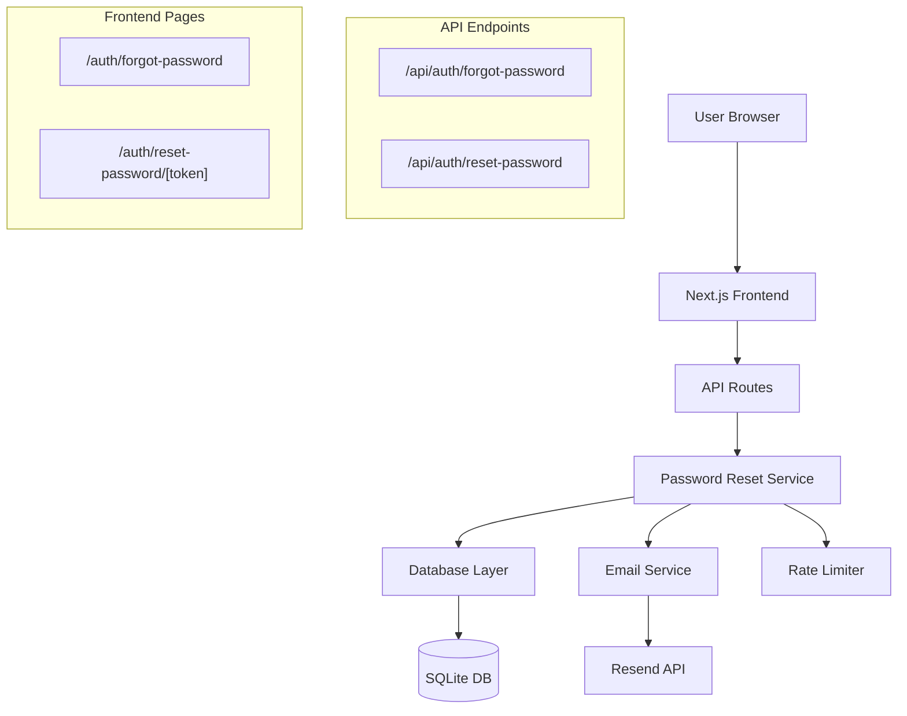
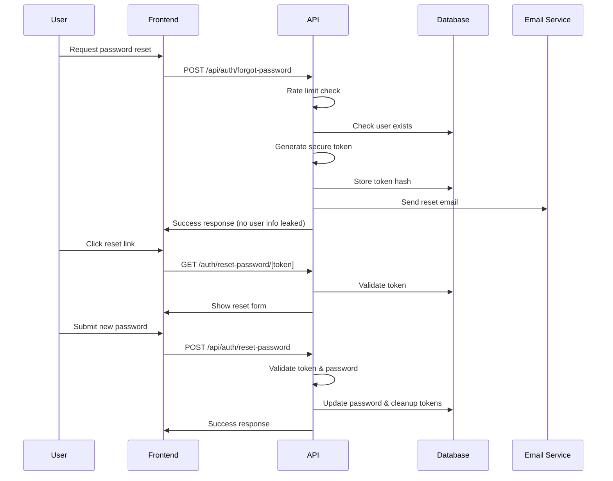

# Design Document: Forgot Password Feature

## Overview

The forgot password feature provides a secure, user-friendly password reset flow for CareerPilot AI users. The system integrates with the existing Next.js application architecture, leveraging Prisma ORM with SQLite database, JWT authentication, and Resend email service. The design follows security best practices including token-based authentication, rate limiting, and protection against user enumeration attacks.

## Architecture

### System Architecture



### Security Flow



## Components and Interfaces

### Core Services

#### PasswordResetService
Handles the business logic for password reset operations.

```typescript
interface PasswordResetService {
  // Generate and send password reset token
  initiateReset(email: string, clientIp: string): Promise<ResetResult>;
  
  // Validate reset token
  validateToken(token: string): Promise<TokenValidation>;
  
  // Complete password reset
  completeReset(token: string, newPassword: string): Promise<ResetResult>;
  
  // Cleanup expired tokens
  cleanupExpiredTokens(): Promise<number>;
}

interface ResetResult {
  success: boolean;
  message: string;
  error?: string;
}

interface TokenValidation {
  valid: boolean;
  userId?: string;
  error?: string;
}
```

#### RateLimiter
Implements IP-based rate limiting for password reset requests.

```typescript
interface RateLimiter {
  checkLimit(ip: string, action: string): Promise<RateLimitResult>;
  recordAttempt(ip: string, action: string): Promise<void>;
}

interface RateLimitResult {
  allowed: boolean;
  remaining: number;
  resetTime: Date;
}
```

#### TokenGenerator
Generates cryptographically secure tokens.

```typescript
interface TokenGenerator {
  generate(): string;
  hash(token: string): string;
  compare(token: string, hash: string): boolean;
}
```

### Data Models

The system extends the existing Prisma schema with the `PasswordResetToken` model:

```typescript
interface PasswordResetToken {
  id: string;
  userId: string;
  tokenHash: string;  // Hashed version for security
  expiresAt: Date;    // 15-minute expiry
  createdAt: Date;
  user: User;         // Relation to User model
}
```

### API Interfaces

#### Request/Response Types

```typescript
// Forgot password request
interface ForgotPasswordRequest {
  email: string;
}

interface ForgotPasswordResponse {
  success: boolean;
  message: string;
}

// Reset password request
interface ResetPasswordRequest {
  token: string;
  newPassword: string;
}

interface ResetPasswordResponse {
  success: boolean;
  message: string;
  redirect?: string;
}

// Token validation
interface TokenValidationResponse {
  valid: boolean;
  error?: string;
}
```

## Data Models

### Extended Database Schema

The forgot password feature utilizes the existing `PasswordResetToken` model and extends related functionality:

```prisma
model PasswordResetToken {
  id        String   @id @default(cuid())
  userId    String
  tokenHash String   @unique      // Hashed token for security
  expiresAt DateTime             // 15-minute expiry
  createdAt DateTime @default(now())

  user User @relation(fields: [userId], references: [id], onDelete: Cascade)

  @@map("password_reset_tokens")
}

// SystemLog entries for password reset events
model SystemLog {
  id        String   @id @default(cuid())
  userId    String?
  action    String   // "PASSWORD_RESET_REQUESTED", "PASSWORD_RESET_COMPLETED"
  details   String   @default("")  // JSON with IP, timestamp, etc.
  createdAt DateTime @default(now())

  user User? @relation(fields: [userId], references: [id], onDelete: SetNull)
  
  @@map("system_logs")
}
```

### In-Memory Rate Limiting

```typescript
interface RateLimitEntry {
  ip: string;
  attempts: number;
  windowStart: Date;
  lastAttempt: Date;
}

// In-memory store for development, Redis recommended for production
interface RateLimitStore {
  [ip: string]: RateLimitEntry;
}
```

## Correctness Properties

*A property is a characteristic or behavior that should hold true across all valid executions of a system-essentially, a formal statement about what the system should do. Properties serve as the bridge between human-readable specifications and machine-verifiable correctness guarantees.*

### Property 1: Token Security and Uniqueness

*For any* password reset request, the generated token should be cryptographically secure (minimum 32 bytes), unique across the system, and only the hashed version should be stored in the database.

**Validates: Requirements 1.1, 1.2, 3.1, 3.6**

### Property 2: Token Expiry Enforcement

*For any* password reset token, the system should reject the token if the current time exceeds the expiry time (15 minutes from creation).

**Validates: Requirements 1.3, 3.2**

### Property 3: Single Active Token per User

*For any* user, when a new password reset token is created, all existing active tokens for that user should be invalidated immediately.

**Validates: Requirements 1.4**

### Property 4: Rate Limiting Consistency

*For any* IP address, the system should consistently enforce the rate limit of maximum 3 password reset requests per minute, regardless of email validity.

**Validates: Requirements 1.6, 8.2, 8.3**

### Property 5: User Enumeration Prevention

*For any* password reset request, the system response should be identical regardless of whether the provided email exists in the system, taking the same time to respond.

**Validates: Requirements 1.5, 2.6, 8.4, 8.6**

### Property 6: Token One-Time Use

*For any* valid password reset token, once it is used to successfully reset a password, the token should be immediately invalidated and cannot be reused.

**Validates: Requirements 3.3, 4.6**

### Property 7: Password Security Requirements

*For any* submitted new password, the system should enforce minimum security requirements (8+ characters, uppercase, lowercase, number) and hash using bcrypt with 12 salt rounds.

**Validates: Requirements 4.4, 4.5**

### Property 8: Database Consistency

*For any* successful password reset, all related reset tokens for that user should be deleted from the database, maintaining referential integrity.

**Validates: Requirements 5.4, 5.6**

### Property 9: Constant Time Comparison

*For any* token validation operation, the system should use constant-time comparison to prevent timing attacks, regardless of token validity.

**Validates: Requirements 3.4**

### Property 10: Email Delivery Resilience

*For any* password reset email that fails to send, the system should still return a success response to prevent user enumeration while logging the error internally.

**Validates: Requirements 2.6**

## Error Handling

### Error Categories

#### Client Errors (4xx)
- **400 Bad Request**: Invalid email format, missing required fields
- **429 Too Many Requests**: Rate limit exceeded
- **404 Not Found**: Invalid or expired token
- **422 Unprocessable Entity**: Password validation failures

#### Server Errors (5xx)
- **500 Internal Server Error**: Database connection failures, unexpected errors

### Error Response Format

```typescript
interface ErrorResponse {
  success: false;
  error: string;
  message: string;
  details?: string[];  // For validation errors
}
```

### Error Handling Strategy

1. **Graceful Degradation**: Email sending failures don't block the reset flow
2. **Security-First**: Never leak sensitive information in error messages
3. **User-Friendly Messages**: Provide clear, actionable error messages
4. **Comprehensive Logging**: Log all errors for debugging while protecting user privacy

### Specific Error Scenarios

```typescript
// Rate limit exceeded
{
  success: false,
  error: "RATE_LIMIT_EXCEEDED",
  message: "Too many requests. Please wait before trying again."
}

// Invalid token
{
  success: false,
  error: "INVALID_TOKEN",
  message: "This reset link is invalid or has expired. Please request a new one."
}

// Password validation failure
{
  success: false,
  error: "VALIDATION_FAILED",
  message: "Password does not meet security requirements.",
  details: [
    "Password must be at least 8 characters long",
    "Password must contain at least one uppercase letter"
  ]
}
```

## Testing Strategy

The forgot password feature requires comprehensive testing across multiple layers to ensure security, reliability, and user experience. The testing approach combines property-based testing for business logic validation with integration testing for API endpoints and user interface components.

### Unit Testing

**Core Business Logic Tests:**
- Token generation and validation functions
- Password hashing and verification utilities
- Rate limiting logic and cleanup operations
- Email template generation and formatting
- Input validation and sanitization

**Database Operations Tests:**
- CRUD operations for password reset tokens
- User lookup and password update operations
- Token cleanup and expiry handling
- Foreign key constraint validation

### Property-Based Testing

Property-based tests validate the universal correctness properties defined in the design:

**Test Configuration:**
- **Framework**: `fast-check` for TypeScript
- **Iterations**: 100 per property test
- **Generators**: Custom generators for emails, tokens, passwords, and timestamps

**Property Test Implementation:**
Each correctness property maps to a specific property-based test with the tag format:
`// Feature: forgot-password-feature, Property N: [property description]`

### Integration Testing

**API Endpoint Tests:**
- `/api/auth/forgot-password` - Request handling and response consistency
- `/api/auth/reset-password` - Token validation and password updates
- Error handling and status code validation
- Rate limiting behavior verification

**Email Integration Tests:**
- Email service integration with Resend API
- Template rendering and link generation
- Fallback behavior when email service is unavailable

**Database Integration Tests:**
- Token storage and retrieval operations
- User password updates and transaction integrity
- Cleanup operations for expired tokens

### Frontend Testing

**Component Tests:**
- Forgot password form validation and submission
- Reset password form with token validation
- Loading states and error message display
- Navigation and redirect behavior

**End-to-End Tests:**
- Complete password reset flow from request to completion
- Error scenarios and recovery paths
- Cross-browser compatibility for email links
- Mobile responsiveness validation

### Security Testing

**Penetration Testing Scenarios:**
- Rate limit bypass attempts
- Token enumeration and timing attacks
- User enumeration prevention verification
- CSRF and injection attack resistance

**Performance Testing:**
- Concurrent request handling (100+ simultaneous requests)
- Response time validation (sub-2 second requirement)
- Memory usage during token cleanup operations
- Email queue performance under load

### Test Data Management

**Test Database Setup:**
- Isolated test database with seed data
- Automated cleanup between test runs
- Mock email service for consistent testing
- Timezone-aware date/time testing

**Test Coverage Requirements:**
- **Unit Tests**: 95% code coverage for business logic
- **Integration Tests**: All API endpoints and database operations
- **Property Tests**: All defined correctness properties
- **E2E Tests**: Critical user paths and error scenarios

The testing strategy ensures that the forgot password feature meets all security requirements while providing a reliable, user-friendly experience across different scenarios and edge cases.