# Technical Design: Recruiter Hiring Workspace

## Design Status and Scope

**Feature:** `recruiter-hiring-workspace`  
**Workflow:** Requirements-first feature workflow  
**Phase:** Technical design — ready for review; implementation tasks are intentionally not created by this document.

This design implements only the approved Phase 2 recruiter-facing presentation: Job Posting, Manage Jobs, Candidate List, Candidate Profile, and application-status action presentation behind its current integration gate. It consumes only the verified existing recruiter job and application operations. It neither prescribes nor authorizes changes to backend routes, data models, Prisma schema, authentication, AI services, dashboard APIs, or student application submission.

The protected Phase 1 Recruiter Dashboard remains visually and behaviorally unchanged: its `/recruiter/dashboard` route, `KPIStatsCards`, `HiringFunnel`, `CopilotPanel`, `RecentActivityTimeline`, and existing `RecruiterHeader` are retained without modification. Phase 3 analytics, reports, AI ranking, candidate comparison, executive dashboard, and hiring insights remain explicitly out of scope.

## Overview

### Purpose

The Recruiter Hiring Workspace gives an authenticated recruiter a bounded client-side workspace to create and manage their existing job records, review the recruiter-owned applications returned by the current API, and inspect a source-backed application detail view. It makes the distinction between **available source-backed capability** and **unavailable integration-dependent capability** visible at every relevant interaction.

The central design rule is source fidelity: the UI only claims that data was saved, exists, or changed when the existing API has returned that source-backed value. Requested fields and actions which the current contracts cannot persist or retrieve remain visible when required, but have clear non-persistence or unavailable disclosures rather than synthetic values, optimistic status changes, or invented requests.

### Approved UI Areas

| Area | User outcome | Existing contract used | Bounded behavior |
| --- | --- | --- | --- |
| Job Posting | Create a role and edit a persisted role | `POST /api/recruiter/jobs`; `GET`/`PUT /api/recruiter/jobs/[id]` | Serializes only supported job fields; keeps Company profile-derived and aspirational fields visibly non-persisted. |
| Manage Jobs | Search, filter, sort, paginate, edit, and change lifecycle of owned jobs | `GET /api/recruiter/jobs`; `GET`/`PUT /api/recruiter/jobs/[id]` | Uses a deterministic local transform over the last successful collection; lifecycle status comes only from the `PUT` response. |
| Candidate List | Find, page through, locally sort the current page, and open applicant records | `GET /api/recruiter/applications` | Uses only supported query parameters; ATS and resume remain unavailable until a detail response for that same application is retrieved. |
| Candidate Profile | Review returned resume, analysis, education, status, and application time | `GET /api/recruiter/applications/[id]` | Projects only permitted detail fields; uses explicit unavailable/placeholder states for roadmap, projects, history, and notes. |
| Application Management | See requested status actions and the current status | Existing application `GET` operations only | Renders all five actions disabled and explains D1; sends no mutation. A future adapter boundary is specified but no endpoint is invented. |

### Research Findings That Inform This Design

The approved requirements document is the source of truth for scope and API capability. Repository inspection confirms the following implementation constraints and reusable patterns:

- [`RecruiterHeader`](../../../src/components/layout/RecruiterHeader.tsx) already exposes `/recruiter/jobs` and `/recruiter/candidates`, with nested paths considered active. The Phase 2 route plan therefore fits existing navigation without altering that component.
- [`RecruiterLayout`](../../../src/app/recruiter/layout.tsx) mounts `RecruiterHeader` and `AuthProvider` for all recruiter routes. Phase 2 pages stay beneath that layout, preserving the existing authentication and header boundary.
- [`RecruiterDashboard`](../../../src/app/recruiter/dashboard/page.tsx) is the protected Phase 1 composition and already establishes safe request sequencing, accessible skeletons, error cards, and `useReducedMotion` usage. It is not shared as a mutable implementation target.
- [`Card`](../../../src/components/ui/Card.tsx), [`Button`](../../../src/components/ui/Button.tsx), and [`Badge`](../../../src/components/ui/Badge.tsx), together with [global glass, table, skeleton, and dark-mode styles](../../../src/app/globals.css), establish the CareerPilot dark glassmorphism system to reuse rather than replace.
- The existing job collection/create route and job detail/update route ([collection](../../../src/app/api/recruiter/jobs/route.ts), [detail](../../../src/app/api/recruiter/jobs/[id]/route.ts)) accept precisely the supported job write fields. The create route derives Company from the recruiter profile.
- The application collection route ([collection](../../../src/app/api/recruiter/applications/route.ts)) accepts only `jobId`, `status`, `search`, `page`, and `pageSize`; the application detail route ([detail](../../../src/app/api/recruiter/applications/[id]/route.ts)) has no mutation operation and returns the scoped resume/analysis data described in the requirements.
- The current test runner is Vitest (`npm run test:run`) as declared in [`package.json`](../../../package.json). Property-based testing is applicable only to pure client transforms, projection, and request serialization; it is not applicable to live API behavior or currently absent status mutation.

No external research is required: the approved requirements and inspected application code are authoritative for this design.

### Goals

1. Add Phase 2 routes that coexist with the current recruiter dashboard and reuse the existing header and visual primitives.
2. Keep all network activity inside verified recruiter job/application operations and serialize requests strictly to their documented fields.
3. Make missing persistence and mutation capabilities understandable, non-selectable, and harmless.
4. Make collection transforms deterministic, stable, and testable without implying server-side search/sort behavior that does not exist.
5. Present loading, empty, error, success, and unavailable states accessibly on mobile and desktop.

### Non-Goals and Explicit Boundaries

- No API route, Prisma schema/model, authentication, AI, dashboard endpoint, or student submission change.
- No persisted Company edits, employment type, experience, skills, benefits, recruiter notes, roadmap, structured projects, or application-status history.
- No application status mutation, optimistic application-status UI, inferred ATS score, inferred resume filename, or synthetic candidate identity.
- No Phase 3 navigation, controls, data calls, or placeholder implementations for analytics, reports, AI ranking, candidate comparison, executive dashboard, or hiring insights.
- No modification to protected Phase 1 unless a separately approved, reproducible Critical_Bug is identified and documented with boundary, preconditions, input, steps, expected result, and observed result.

## Architecture

### Route and Isolation Strategy

The new pages use existing recruiter URL conventions while leaving `/recruiter/dashboard` untouched. An optional route group may organize Phase 2 source files without changing these URLs; it must be scoped so that it cannot wrap or alter the protected dashboard.

| Route | Presentation | Data activity | Protection rule |
| --- | --- | --- | --- |
| `/recruiter/dashboard` | Existing Phase 1 dashboard | Existing dashboard/copilot calls only | No Phase 2 component, request, or visual change. |
| `/recruiter/jobs` | Manage Jobs | One unparameterized `GET /api/recruiter/jobs` plus user-initiated job-detail/lifecycle operations | The existing Header Jobs link remains the entry point. |
| `/recruiter/jobs/new` | Job Posting, create mode | `POST /api/recruiter/jobs` only after local validation | Starts unpersisted; auto-save is unavailable. |
| `/recruiter/jobs/[id]/edit` | Job Posting, persisted edit mode | `GET /api/recruiter/jobs/[id]`, followed by eligible `PUT` only | Shows persisted values only after owned-job detail succeeds. |
| `/recruiter/candidates` | Candidate List | `GET /api/recruiter/applications` with verified query keys | The existing Header Candidates link remains the entry point. |
| `/recruiter/candidates/[id]` | Candidate Profile | `GET /api/recruiter/applications/[id]` | Clears old source values before error display. |

```mermaid
flowchart TD
  RH[Existing RecruiterHeader\nunchanged] --> D[/recruiter/dashboard\nProtected Phase 1]
  RH --> MJ[/recruiter/jobs\nManage Jobs]
  RH --> CL[/recruiter/candidates\nCandidate List]
  MJ --> JPNew[/recruiter/jobs/new\nJob Posting]
  MJ --> JPEdit[/recruiter/jobs/:id/edit\nJob Posting]
  CL --> CP[/recruiter/candidates/:id\nCandidate Profile]

  D --> DAPI[Existing dashboard + copilot APIs only]
  MJ --> JCOL[GET /api/recruiter/jobs]
  MJ --> JDETAIL[GET /api/recruiter/jobs/:id]
  JPNew --> JPOST[POST /api/recruiter/jobs]
  JPEdit --> JPUT[PUT /api/recruiter/jobs/:id]
  CL --> ACOL[GET /api/recruiter/applications\nallowed query keys only]
  CL --> ADETAIL[GET /api/recruiter/applications/:id\nbounded per selected candidate]
  CP --> ADETAIL

  CP --> Gate{Approved status mutation\nintegration available?}
  Gate -- No: current state --> Unavailable[Disabled actions + D1 feedback\nno write request]
  Gate -. Separate approval only .-> Adapter[Future mutation adapter boundary]
```

The dotted adapter is intentionally not connected to a URL, HTTP method, schema change, or production implementation. It is an integration seam that remains inactive until D1 is separately approved.

### Client Data Flow

1. Each route owns a request state with its latest accepted request snapshot, a monotonically increasing request token, and its last successful source-backed result. A completed response updates view state only if it belongs to the latest request token. Superseded requests may be aborted when practical; stale responses are ignored regardless.
2. Collection routes first normalize only the fields they are entitled to display. Invalid or omitted optional source fields become an Unavailability_Indicator; normalization never invents a business value.
3. Manage Jobs holds the last successful raw job collection as its immutable transform input. Search, status filter, sort, and pagination derive visible rows locally without a follow-up collection request.
4. Candidate List sends a new request only for an accepted server-supported filter/pagination state. Its local sort derives a display order only for the received page.
5. Candidate detail loading is bounded. The list does **not** fan out one detail request per visible row. The candidate-detail action starts one detail request for the selected application, marks that row loading, and on success stores the response in a route-scoped cache keyed by application ID before opening the profile. A direct profile URL makes the same single detail request. ATS/resume cells use only the matching cached detail response; otherwise they say unavailable in list data.
6. Job create, job update, eligible auto-save, and job lifecycle transitions construct a fresh whitelisted payload at the boundary. They update source-backed state only from a successful response and retain client form input on failure.
7. Application status controls inspect a fixed current capability configuration containing no mutation adapter. They remain disabled, expose D1 feedback, and never construct a write request.

### API Ownership and Request Boundaries

| Operation | Trigger | Request | Result handling |
| --- | --- | --- | --- |
| Load jobs | Manage Jobs entry/retry | `GET /api/recruiter/jobs` with **no** query parameters | Replace the raw collection only on success; preserve last collection on refresh failure. |
| Load one job | Edit action / edit route | `GET /api/recruiter/jobs/[id]` | Populate only persisted supported fields and source-backed Company after success. |
| Create job | Valid explicit save in create mode | `POST /api/recruiter/jobs` with the six supported fields only | Use returned Job as the persisted source record; disclose local-only fields before success feedback. |
| Update job | Valid explicit save in edit mode | `PUT /api/recruiter/jobs/[id]` with the six supported fields only | Replace saved supported snapshot only from returned Job. |
| Auto-save draft | Debounced eligible supported-field edit | Same `PUT` payload as update | Serializes one snapshot at a time; reports saving/saved/error without persisting unsupported values. |
| Change job lifecycle | Confirmed Publish, Archive, or Draft | `PUT /api/recruiter/jobs/[id]` with supported fields and exact target status | Status badge uses the returned `status` only. |
| Load candidates | Entry, accepted filter/page change, retry | `GET /api/recruiter/applications` with only `jobId`, `status`, `search`, `page`, `pageSize` | Pagination uses returned `total`, `page`, `pageSize`; error preserves prior successful page. |
| Load candidate detail | Candidate-detail action, direct profile entry, retry | `GET /api/recruiter/applications/[id]` | Cache/project only the response belonging to that application ID. |
| Change application status | Never in the current system | No request | Show disabled actions, D1 explanation, and current source-backed badge. |

### Job Form Save and Auto-Save State Machine

```mermaid
stateDiagram-v2
  [*] --> Editing
  Editing --> TitleInvalid: trim(title) is empty on save
  TitleInvalid --> Editing: title changes
  Editing --> ExplicitSaving: valid explicit create/update
  ExplicitSaving --> Persisted: successful returned Job
  ExplicitSaving --> SaveError: failed response; retain all form values
  SaveError --> Editing: retry or edit

  Persisted --> AutoSaveEligible: id + DRAFT + nonblank trimmed title
  AutoSaveEligible --> AutoSaving: supported field changes after debounce
  AutoSaving --> AutoSaveEligible: successful returned supported values
  AutoSaving --> AutoSaveError: failed response; retain all form values
  AutoSaveError --> AutoSaveEligible: retry/edit remains eligible
  Persisted --> AutoSaveUnavailable: published/archived or invalid title
  Editing --> AutoSaveUnavailable: no persisted ID
```



Auto-save is a convenience for only the current, persisted DRAFT record. It is unavailable for a new form, an invalid title, and any non-DRAFT status. It is also unavailable for aspirational-field-only edits: those edits are retained in the current form but cannot schedule, merge into, or claim completion through an auto-save request.

To prevent an earlier response from overwriting later input, the form queues at most one current `PUT` snapshot. If a supported edit occurs while a save is pending, it marks the form dirty; after the pending response settles, the latest eligible snapshot is re-evaluated and saved. Returned fields update the saved snapshot only when they correspond to the latest accepted request. Unsupported field values remain local client input and are never overwritten by a source response that did not contain them.

## Components and Interfaces

### Existing Components and Patterns to Reuse

| Existing asset | Required reuse in Phase 2 |
| --- | --- |
| `RecruiterHeader` | Remains the shared recruiter header unchanged. Its Jobs and Candidates links provide top-level entry points. |
| `Card`, `CardHeader`, `CardContent`, `CardFooter` | Glass surfaces for forms, tables, profile sections, empty states, and feedback. |
| `Button` | Primary, secondary, destructive, outline, and disabled controls with the established focus ring and dark background offset. |
| `Badge` | Base primitive for `StatusBadge`; text and optional icon/dot supplement color. |
| `.skeleton`, `.data-table`, `.glass-card` | Existing loading, data-table, and glassmorphism foundations, adapted with semantic labels and mobile alternatives. |
| `useReducedMotion` / existing motion approach | Suppress non-essential entrance, shimmer, and state-transition motion when requested; no animation is the only state signal. |

### Proposed Phase 2 Presentation Components

These are logical component responsibilities, not implementation tasks. They are deliberately client-presentation components that call the verified endpoints through a small request layer; none owns server or schema changes.

| Component | Responsibility | Critical rules |
| --- | --- | --- |
| `WorkspacePageShell` / `WorkspacePageHeader` | Phase 2 page framing, breadcrumbs/back links, and actions | Uses the existing dark backdrop/Card patterns; never wraps or changes the protected dashboard. |
| `StatusBadge` | Maps a source-backed job or application status to text, badge variant, and non-color marker/icon | Displays the exact returned status text; no optimistic or guessed status. |
| `LoadingSkeleton` | Region-shaped loading placeholder | `aria-busy="true"` and accessible region-specific name. |
| `EmptyState` | Successful-zero result presentation | Gives only a Phase 2 next action, such as Create Job or Clear filters. |
| `ErrorState` | Safe failure message and valid retry action | Uses `role="alert"`; retries the exact accepted request snapshot once per activation. |
| `UnavailabilityIndicator` | Explicit source-data/integration-gap disclosure | Visually distinct from a value; names the applicable dependency where needed. |
| `JobForm` | Create/edit fields, local validation, explicit save, auto-save status | Keeps all `Job_Form_Field_Set` values in local state on every failed save. |
| `FieldPersistenceNotice` | Reusable field-level disclosure | Company is profile-derived; Employment Type, Experience, Skills, and Benefits are local-only under D2. |
| `JobSaveFeedback` | Validating, saving, saved, and failed form feedback | Saved copy enumerates only returned supported fields. |
| `JobLifecycleDialog` | Confirm Publish, Archive, or Draft | Uses the existing dialog behavior contract; does not confirm an application action. |
| `ManageJobsControls` / `ManageJobsTable` | Local search/filter/sort/page controls and desktop table/mobile list | Reads the immutable fetched collection through `Job_Collection_Transform`. |
| `CandidateFilters` / `CandidateTable` | Server-supported filters, returned pagination, and page-scoped sort | Labels sort scope; table uses cached details only for same-ID ATS/resume cells. |
| `CandidateDetailLauncher` | Starts exactly one selected-detail fetch before navigation | Provides row-local loading/error feedback; avoids automatic N+1 loading. |
| `CandidateProfile` | Source-backed resume, analysis, education, status, timeline, unavailable sections | Clears old data on a failed/inaccessible response. |
| `ResumeSection`, `AnalysisSection`, `EducationSection`, `ApplicationTimeline` | Semantically grouped candidate data | Original resume text is rendered as text, preserving whitespace, not interpreted as HTML. |
| `NotesPlaceholder` | Visible non-persisted notes area | Clearly says no note storage is available; does not imply save. |
| `ApplicationStatusActions` | Renders five status action controls and feedback | Current configuration renders every control disabled/non-selectable and explains D1. |
| `ConfirmationDialog` | Shared future-capable confirmation boundary | Only mounts when a separately approved adapter is available; manages focus in/out. |

### Form Contract and Field Disclosure Matrix

| Form field | Display behavior | Source/persistence behavior | Request behavior |
| --- | --- | --- | --- |
| Job Title | Required text field; trim only for validation and serialization | Supported; returned title becomes saved source state | Send trimmed `title`; block blank-after-trim. |
| Company | Rendered as profile-derived/read-only context, with unavailable fallback if profile value is not available to the client | Created by the job API from recruiter profile; not client-persisted or editable | Never send. |
| Location | Editable text | Supported | Send `location`. |
| Employment Type | Editable local form field with persistent disclosure | D2: not in current Job model/API | Never send; show local-only warning before success. |
| Experience | Editable local form field with persistent disclosure | D2: not in current Job model/API | Never send; show local-only warning before success. |
| Salary | Editable text | Supported | Send `salary`. |
| Skills | Editable local form field with persistent disclosure | D2: not in current Job model/API | Never send; show local-only warning before success. |
| Description | Editable multiline text | Supported | Send `description`. |
| Requirements | Editable multiline text | Supported | Send `requirements`. |
| Benefits | Editable local form field with persistent disclosure | D2: not in current Job model/API | Never send; show local-only warning before success. |
| Status | Source-backed lifecycle state; controls restrict Phase 2 values to `DRAFT`, `PUBLISHED`, `ARCHIVED` | Supported | Send `status` only through create/update/lifecycle contract. |

Before any create/update success confirmation, if a recruiter entered one or more local-only field values, the form shows: “Employment type, experience, skills, and benefits are shown in this form but are not stored by the current job service. They will not be included in this save.” Company shows a separate message: “Company is derived from your recruiter profile and is not sent from this form.” This disclosure remains visible during saving and is not replaced by a misleading generic success toast.

### Job and Application Request Interfaces

The following interfaces document serialization and presentation boundaries. They are intentionally transport-focused and do not redefine server schema.

```ts
// The only job write shape constructed by the client.
type SupportedJobWrite = {
  title: string;        // trimmed and nonblank before send
  description: string;
  location: string;
  salary: string;
  requirements: string;
  status: "DRAFT" | "PUBLISHED" | "ARCHIVED";
};

type JobFormState = SupportedJobWrite & {
  companyDisplay: string | null;       // profile-derived display only
  employmentType: string;              // local-only, D2
  experience: string;                  // local-only, D2
  skills: string;                      // local-only, D2
  benefits: string;                    // local-only, D2
};

type ApplicationListQuery = {
  jobId?: string;
  status?: string;
  search?: string;
  page: number;
  pageSize: number; // constrained to 1..50
};

type StatusAction =
  | "SHORTLIST"
  | "REJECT"
  | "MOVE_TO_INTERVIEW"
  | "OFFER"
  | "HIRE";

// Boundary only: absent in the current capability configuration.
type ApprovedApplicationStatusMutationAdapter = {
  updateStatus: (
    applicationId: string,
    action: StatusAction
  ) => Promise<{ application: { status: string } }>;
};
```

`serializeJob(form)` always creates a new `SupportedJobWrite`, trims `title`, and returns a local validation result instead of a request intent if the title is blank. It does not spread the form object, accept arbitrary keys, or serialize `companyDisplay`, `employmentType`, `experience`, `skills`, or `benefits`. Create, explicit update, lifecycle update, and eligible auto-save all use this same whitelist.

The optional mutation adapter is `undefined` in the current capability configuration. Its declaration identifies a future confirmation/result boundary only; it does not authorize, suggest, or hide a route, mutation method, or backend implementation.

### Manage Jobs Transform Interface

`Job_Collection_Transform` takes the last successful `GET /api/recruiter/jobs` collection plus UI state; it never mutates the fetched collection or sends query parameters.

1. Decorate each source Job with its original source index and a display adapter containing only source-backed Job, Status, Applications, Created, and Updated values.
2. Normalize a nonempty search phrase for comparison and retain jobs whose source-backed title, company, or location contains it. A missing optional text field is treated as an empty comparison value, never as a displayed replacement.
3. If a status filter is selected, retain only records whose source-backed status exactly equals that filter.
4. If no sort is selected, preserve the source collection order. If a sort is selected, compare the selected source-backed field in the requested direction; Job and Status use normalized text, Applications uses numeric count, and Created/Updated use valid timestamps. Missing/invalid values sort after valid values in both directions. Equal comparison values resolve by original source index, preserving stable source order.
5. Slice the transformed result using the local Manage Jobs page selection and fixed presentation page size. Search/filter/sort changes reset the local page to the first valid page; an out-of-range selected page is clamped to the last valid page.

The table shows source-backed application count and status. A lifecycle confirmation maps exactly to `PUBLISHED`, `ARCHIVED`, or `DRAFT`; following success, the row status badge renders only the returned status, and the stored collection is reconciled only with returned source-backed job data.

### Candidate List and Detail Projection Interface

The candidate collection is server-paged; filters are serialized as the exact permitted query-key set. Empty optional filters are omitted rather than represented by unsupported parameters. `page` is positive and `pageSize` is bounded from 1 through 50 before serializing.

Candidate identity and source-fidelity mapping follow this precedence:

| Displayed cell/section | Source-backed value | If absent | Never do |
| --- | --- | --- | --- |
| Candidate | `studentProfile.fullName` | User email, then Unavailability_Indicator | Invent a name, initials, or ATS-derived identity. |
| ATS (list) | `analysis.atsScore` from the matching cached detail response | “Unavailable in list data” indicator | Calculate or infer a score. |
| Resume (list) | `resume.filename` from the matching cached detail response | “Unavailable in list data” indicator | Show a filename from another application or invent one. |
| Applied Date | List response application creation date | Unavailability_Indicator if missing/invalid | Substitute current date. |
| Status | List response application status | Unavailability_Indicator if absent | Infer from action names. |
| Profile resume | Detail `resume.filename` and exact `resume.originalText` | Resume Empty_State | Render markup from original text or fabricate content. |
| Profile analysis | Detail ATS, hidden skills, keyword suggestions, strengths, weaknesses, experience score, education score | Unavailability_Indicator per absent analysis section/value | Generate AI analysis or values. |
| Education | Detail student-profile college and degree | Unavailability_Indicator | Infer from resume text. |
| Timeline | Detail application creation date | Unavailability_Indicator | Make a status history. |

Candidate table sorting is a stable, deterministic client-side comparison of the current returned page only. It supports Candidate, ATS, Applied Date, Resume, and Status in ascending/descending direction. Null/unavailable values remain after available values in either direction; equality preserves the response order. A visible label states: “Sorting applies to this page only; the application service does not provide server-wide sorting.” Sorting never changes the `total`, `page`, or `pageSize` returned by the API.

The detail cache is keyed strictly by application ID and records loading/success/error state per key. It is not used to populate a different row and does not trigger an automatic page-wide fetch. A fresh Candidate List response remains the authority for list status and pagination; a detail response only enriches ATS/resume fields for its same ID.

### Candidate Profile and Application-Action Interface

Candidate Profile projects only the scoped application detail data allowed by the requirements:

- **Resume:** exact filename and original text when `resume` is present; otherwise a Resume Empty_State.
- **Analysis:** ATS score, hidden skills, keyword suggestions, strengths, weaknesses, experience score, and education score, labelled as analysis data. Absent analysis stays visibly unavailable rather than rendered as zero or an empty claimed score.
- **Education:** returned college and degree when present.
- **Application status:** the exact current source-backed status in a `StatusBadge`.
- **Timeline:** returned application creation date as the single source-backed “Applied” event.
- **Roadmap, Projects, extra timeline/status history:** persistent D4 Unavailability_Indicators.
- **Notes:** a visibly non-persisted `NotesPlaceholder`; no saved-note affordance, autosave, or source-looking note content.

Five Application_Status_Actions—Shortlist, Reject, Move to Interview, Offer, and Hire—are present whenever a source-backed application is shown. In the current integration configuration all five are disabled/non-selectable, carry an unavailable label, and are paired with an Action_Feedback region explaining: “Status updates are unavailable because the current recruiter application service exposes no approved status-mutation operation (D1).” No click handler can produce a write intent while this gate is active.

If D1 is separately resolved and an approved adapter is injected, only then does an enabled action open an accessible confirmation dialog. The dialog identifies the source-backed candidate label (full name, otherwise email, otherwise “candidate unavailable”) and proposed target action; Cancel sends zero requests and returns focus to the trigger. Confirm disables duplicate submission, calls the adapter exactly once, replaces the badge only with `response.application.status`, and preserves the previous source-backed badge plus ErrorState on failure.

## Data Models

### Data Classification

| Classification | Examples | UI rule |
| --- | --- | --- |
| Source-backed persisted Job | id, title, company, location, salary, description, requirements, status, timestamps, application count | Render from a successful verified response; treat response as authoritative. |
| Local-only job form value | employmentType, experience, skills, benefits; Company display context | Keep in current form state only; disclose non-persistence; omit from every write. |
| Source-backed application list value | application id/status/date, job context, user email, student full name when supplied, returned pagination | Use directly or display unavailable; never enrich automatically with unreturned details. |
| Source-backed application detail value | resume, analysis, college, degree, current status, creation date | Use only in its matching candidate profile/list cache entry. |
| Derived presentation value | trimmed title validation, formatted date, stable sort key, local page slice, candidate fallback label | Derive deterministically from source/local values; label scope where it could be confused with source data. |
| Explicitly unavailable/blocked | status mutations, D2 fields persistence, ATS/resume before detail, roadmap/projects/history/notes | Use named unavailability or placeholder state, never a plausible substitute. |

### View-State Model

Every remote resource uses a common conceptual state:

```ts
type ResourceState<TRequest, TData> = {
  phase: "idle" | "loading" | "refreshing" | "success" | "error";
  request: TRequest | null;           // latest accepted request values
  lastSuccess: TData | null;          // source-backed snapshot
  errorMessage: string | null;        // safe server message or client fallback
  requestToken: number;               // rejects stale completion
};

type MutationState =
  | { phase: "idle" }
  | { phase: "validating"; message: string }
  | { phase: "saving"; action: string }
  | { phase: "saved"; action: string; returnedFields: readonly string[] }
  | { phase: "error"; action: string; message: string };
```

For initial collection failure, `lastSuccess` is null and the UI presents only an ErrorState—never synthetic table rows. For a later refresh failure, the prior source-backed result remains visible with an adjacent ErrorState. Candidate Profile intentionally differs: it clears `lastSuccess` before loading/retrying a different or inaccessible ID so no source values can leak from a previous candidate.

### Date, Text, and Value Presentation

- Keep original API values in the source snapshot. Format valid source timestamps for visual readability while retaining a semantic `<time dateTime>` source value. An absent/invalid date is unavailable, never “today.”
- Render resume original text as escaped text in a pre-wrapped region; no HTML interpretation, linkification, or AI summary is introduced.
- Use source status text as the badge text. The badge variant may be a deterministic visual mapping, but text/icon always convey the status without relying on color.
- Keep local-only values separate from returned Job values so an API success cannot be interpreted as confirmation that D2 fields were stored.
- Treat the API error body as untrusted data. Display only an expected safe `error` string when present; otherwise use a bounded generic message. Never expose stack traces or request bodies.


## Correctness Properties

Property-based testing is appropriate for the deterministic client-side logic in this feature: title validation, whitelisted request serialization, local collection transforms, response projection, capability gating, and mocked request state transitions. It is **not** used to test live API behavior, visual layout, external authentication, or the absent application-status mutation. Those concerns use component, contract, accessibility, and smoke tests described below.

*A property is a characteristic or behavior that should hold true across all valid executions of a system—essentially, a formal statement about what the system should do. Properties serve as the bridge between human-readable specifications and machine-verifiable correctness guarantees.*

### Property Reflection

The prework identified several overlapping candidates. The following consolidation avoids redundant tests while retaining distinct failure signals:

- Title trimming, title-required feedback, and request exclusion become one invalid-title property; testing them separately would repeatedly exercise the same validator and request gate.
- Create/update/auto-save payload whitelisting and local-only field exclusion become one serialization property. Auto-save eligibility and its asynchronous outcome remain separate because they test state transitions rather than payload shape.
- Search/filter/sort/page behavior and row projection become one Manage Jobs transform property because stable ordering, source membership, and paging form one deterministic pipeline.
- Candidate name fallback, detail-cache ATS/resume projection, and unavailable fallbacks become one source-fidelity property. Page-scoped sorting remains separate because it tests ordering rather than projection.
- Supported mutation feedback is covered by the draft-save and job-lifecycle properties; a generic duplicate success/failure property is therefore omitted.
- The current D1 safety gate and future confirmation semantics remain separate: the former must be executable now and prove zero writes, while the latter is deliberately blocked until a separately approved adapter exists.

### Property 1: Approved request surface

For all supported Phase 2 read and write intents, the emitted request intent uses only the existing recruiter job or application endpoint and method permitted for that intent; no unsupported endpoint, query key, or mutation method is emitted.

**Validates: Requirements 1.4**

### Property 2: Invalid-title request exclusion

For all job form states whose Job Title is empty after leading and trailing whitespace are trimmed, attempting to save returns title-required validation feedback and emits no create or update request intent.

**Validates: Requirements 2.2, 2.3, 2.4**

### Property 3: Supported job-write serialization and local-only disclosure

For all valid job form states and create, explicit-update, or eligible auto-save intents, the serialized payload contains exactly `title`, `description`, `location`, `salary`, `requirements`, and `status`; it never serializes Company, Employment Type, Experience, Skills, or Benefits. For every form state with entered local-only values, the planned success feedback includes the applicable non-persistence disclosure rather than claiming those values were saved.

**Validates: Requirements 2.5, 2.6, 2.7, 2.8, 2.9, 3.1, 3.3, 3.4**

### Property 4: Draft auto-save eligibility and response fidelity

For all job form states, auto-save is eligible if and only if the job has a persisted identifier, source-backed status `DRAFT`, a nonblank trimmed title, and a supported-field change. For every eligible auto-save with a mocked response, success replaces the saving state only with returned supported values, while failure retains every current form value and reports an auto-save error.

**Validates: Requirements 3.1, 3.2, 3.5, 3.6, 3.7, 3.8**

### Property 5: Manage Jobs transform stability and source fidelity

For all fetched Job collections and valid local search, exact status-filter, sort, and page selections, applying `Job_Collection_Transform` twice yields the same ordered visible identifiers; each identifier occurs at most once and comes from the last successful collection; source order is preserved when no sort is selected or compared values are equal; every visible row’s status and application count equal its source-backed values; and the visible identifiers equal the selected transformed page slice.

**Validates: Requirements 4.3, 4.4, 4.5, 4.6, 4.7**

### Property 6: Job lifecycle result fidelity

For all persisted jobs and lifecycle actions Publish, Archive, and Draft, the lifecycle request uses exactly `PUBLISHED`, `ARCHIVED`, or `DRAFT`, respectively. With mocked `PUT` results, a success renders only the returned status in the Status_Badge; a failure preserves the prior source-backed job data and exposes an Error_State.

**Validates: Requirements 4.9, 4.10, 4.11**

### Property 7: Candidate query and returned-pagination fidelity

For all valid candidate filter and pagination states, the generated list request contains only `jobId`, `status`, `search`, `page`, and `pageSize`, omits empty optional values, and bounds page size from 1 through 50. For all successful mocked list responses, the visible pagination state equals the response’s `total`, `page`, and `pageSize`.

**Validates: Requirements 5.1, 5.8**

### Property 8: Candidate-list source fidelity and same-record detail enrichment

For all candidate list rows and matching detail-cache states, Candidate displays source-backed full name, otherwise source-backed email, otherwise an Unavailability_Indicator; ATS and Resume display the exact source-backed detail value only when the cache entry belongs to that same application ID, otherwise an Unavailability_Indicator; Status and Applied Date are sourced only from the list response. No row produces a synthetic identity, ATS score, filename, date, or cross-application detail value.

**Validates: Requirements 5.3, 5.4, 5.5, 5.6, 5.7**

### Property 9: Candidate-page sort stability and scope

For all retrieved Candidate_List_Response pages, supported candidate sort fields, and ascending or descending directions, sorting is deterministic, returns exactly the page’s original application identifiers with no duplicates, preserves input order for equal sort keys, and never changes returned pagination metadata or uses rows outside the retrieved page.

**Validates: Requirements 5.9, 5.10, 5.11**

### Property 10: Candidate-profile projection and isolation

For all Application_Detail_Response values, the Candidate Profile projects only allowed resume, analysis, education, current-status, and application-date fields; resume filename/original text and analysis values are preserved exactly when present; absent resume, roadmap, projects, history, and notes become the required Empty_State, Unavailability_Indicator, or non-persisted Notes_Placeholder. For every failed or inaccessible target application after any previous successful profile, no source value from the previous application remains visible before Error_State is shown.

**Validates: Requirements 6.2, 6.3, 6.4, 6.5, 6.6, 6.7, 6.8, 6.9, 6.10, 6.11, 6.12**

### Property 11: Current application-status safety gate

For all source-backed applications and all five Application_Status_Actions under the current configuration with no Application_Status_Mutation_Integration, the action is unavailable and non-selectable, its Action_Feedback identifies D1, and activating/rendering the action emits zero data-write or mutation-adapter calls.

**Validates: Requirements 1.6, 1.7, 1.8, 1.9, 7.3, 7.4, 7.5**

### Property 12: Future status-action confirmation semantics

For all source-backed candidates and target actions when—and only when—a separately approved status-mutation adapter is supplied, selecting an action opens a confirmation identifying the candidate and target; cancellation emits zero writes and preserves prior status; confirmation emits one adapter call; a successful result updates the badge only from its returned status; and a failed result preserves prior status and exposes Error_State.

**Validates: Requirements 7.6, 7.7, 7.8, 7.9, 7.10**

**Blocked by:** D1. This property is specified now but becomes executable only after separately approved mutation integration is available.

### Property 13: Retry request snapshot fidelity

For all retryable failed request snapshots, activating Retry emits exactly one repeat request with the same accepted endpoint, method, path parameter, and allowed query/body values; it does not silently add filters, paging values, or write fields.

**Validates: Requirements 8.4, 8.5**

## Error Handling

### Shared Error Rules

All route-level and mutation failures use the existing dark glass `Card`/`Button` visual language and an `ErrorState` with `role="alert"`. The feedback exposes a safe API `error` message when one exists; otherwise it uses a bounded action-specific fallback such as “Unable to load jobs.” It never renders raw response bodies, stack traces, token data, or unsanitized HTML.

A request is retryable only when repeating the same accepted read or supported mutation is valid. Retry captures the accepted request snapshot at failure time and calls it exactly once on each user activation. The control is disabled while that retry is pending. User edits are never discarded merely to make a retry possible.

### Page and Mutation State Matrix

| Surface | Pending | Empty success | Failure before first success | Failure after success | Retry / recovery |
| --- | --- | --- | --- | --- | --- |
| Job Posting create/edit | Field-level saving state and form-wide accessible status | Not applicable | ErrorState/validation beneath affected form area; all fields stay | Same | Correct title or activate retry for valid saved snapshot; no blank-title request. |
| Draft auto-save | “Saving draft” status tied to persisted draft | Not applicable | Not applicable for first load | Retain current form values; replace saving with auto-save ErrorState | Next eligible edit or explicit retry sends a fresh whitelisted snapshot. |
| Manage Jobs | Named table/list skeleton on first load; refresh cue while retaining data | Zero-jobs EmptyState with Create Job | ErrorState and no synthetic rows | Last successful collection remains with error banner | Repeat unparameterized collection request. |
| Job detail/edit | Named form skeleton | Not applicable | ErrorState with no persisted fields displayed | Existing form local input is retained only after an edit save failure; a failed initial detail does not fabricate a record | Retry the same owned-job GET. |
| Job lifecycle | Row/dialog pending state; prevent duplicate confirmation | Not applicable | Not applicable | Preserve prior row source state and show action-specific ErrorState | Retry valid lifecycle request after explicit confirmation. |
| Candidate List | Named candidate-table/list skeleton initially; refresh state otherwise | Zero-record EmptyState based on returned page | ErrorState with no candidate rows | Last successful page/pagination remains with error banner | Repeat identical allowed query values, or replace with accepted filter/page values. |
| Candidate detail launch | Selected row loading state | Not applicable | Row/action error; do not navigate with invented profile data | Cached detail for a different ID is never used | Retry one selected ID GET. |
| Candidate Profile | Named profile skeleton; clear prior ID data before a new route request | Resume-only EmptyState when response has no resume | ErrorState with all source sections clear | Same, including 403/404 | Retry the same application-detail GET. |
| Application status actions | Disabled controls with D1 Action_Feedback | Not applicable | Not applicable | Not applicable under current gate | No retry/mutation exists; explain D1. |

### Validation and Serialization Failures

- Job Title is validated by `trim()` before any request. Blank-after-trim input renders “Job title is required.” and produces no request intent.
- Serializer invariants are defensive even if UI state is manipulated: only the six supported job fields can reach POST/PUT; candidate query parameters are allowlisted and page values are clamped.
- API validation errors do not reset `JobFormState`, including Company display context and all four local-only fields.
- A successful response does not erase local-only field values in the active form, but its success copy stays precise: only source-returned supported values were saved. A refresh later may not reproduce local-only values; the UI must not suggest otherwise.

### Unavailability and Integration-Dependency Feedback

| Dependency | Visible feedback | Execution behavior |
| --- | --- | --- |
| D1 — Application-status mutation | Every action button is disabled with “Unavailable”; Action_Feedback explains no approved mutation operation is exposed. | No dialog, adapter, network write, or optimistic status transition. |
| D2 — Aspirational job persistence / Company | Field-level “Not persisted by current job contract” notices; Company marked profile-derived. | Omit values from all POST/PUT payloads; no saved claim. |
| D3 — List ATS/resume projection | ATS/Resume cells say “Unavailable in list data” until matching detail is retrieved. | Do not make automatic per-row detail requests; never infer data. |
| D4 — Roadmap/projects/history/notes | Named unavailable sections; Notes says “Not saved — note storage is not available.” | No fake history/roadmap/projects or notes save operation. |
| D5 — Server-side job query/candidate sort | Manage Jobs controls say “Applied to loaded jobs”; Candidate List says “Sorting applies to this page only.” | Transform only appropriate fetched data; send no unsupported sort/query parameter. |
| D6 — Auto-save boundary | Auto-save label says unavailable for new, invalid-title, or non-DRAFT job; local-only fields say not persisted. | No auto-save request outside eligible persisted DRAFT supported-field changes. |

## Testing Strategy

### Test Tooling and Execution Model

The existing project uses Vitest (`npm run test:run`). Future implementation should use **fast-check** for the property tests in this design, added as a pinned development dependency at implementation time rather than an open version range. No property-test library is implemented from scratch.

Each executable property below is represented by **one** property-based test, configured for at least 100 generated runs. Each test carries a comment in this exact format:

```ts
// Feature: recruiter-hiring-workspace, Property 5: Manage Jobs transform stability and source fidelity
await fc.assert(/* one property definition */, { numRuns: 100 });
```

The number and title in the comment must match the Correctness Properties section. Property 12 remains a skipped/blocked test declaration until D1 has separately approved an adapter; it must not introduce a test-only production endpoint or mutation workaround.

### Property-Test Mapping

| Design property | Test subject | Generator focus | Mock boundary |
| --- | --- | --- | --- |
| 1 | Request-intent allowlist | Route intents, IDs, query/body shapes | Fetch/request-intent spy; no live writes. |
| 2 | Title validator + save intent | Unicode/ASCII whitespace and text; create/update modes | Serializer spy. |
| 3 | Job write serializer + disclosure planner | All form fields, local-only subsets, statuses | Pure serializer/feedback plan. |
| 4 | Auto-save eligibility/state reducer | ID/status/title/edit sequences, success/failure response values | Mocked PUT promise/state reducer. |
| 5 | `Job_Collection_Transform` | Jobs, optional text/date/count values, filters, sort/page state | Pure transform. |
| 6 | Lifecycle request/result reducer | Three action mappings, returned/failure status | Mocked PUT. |
| 7 | Candidate query serializer/pagination projection | Optional filters, page/pageSize bounds, returned metadata | Pure serializer/mock list result. |
| 8 | Candidate row/detail-cache projection | Full-name/email absence, cache IDs, ATS/resume values | Pure projection. |
| 9 | Candidate current-page sorter | Rows, nulls, ties, fields, directions | Pure transform. |
| 10 | Candidate profile projector/reset reducer | Allowed/malformed/extra detail fields, old/new IDs, failures | Pure projection/mock failure state. |
| 11 | Current status-action gate | Application IDs/statuses and all five actions | Mutation spy/adaptor absence. |
| 12 (blocked) | Future confirmation reducer | Candidate fallback labels, actions, success/failure/cancel | Mock approved adapter after D1 approval. |
| 13 | Retry request snapshot builder | GET/mutation request snapshots and allowed values | Fetch/request-intent spy. |

### Example-Based Unit and Component Tests

Keep example tests focused on fixed behavior, edge conditions, and integration boundaries that are not better served by broad generation:

- Render Job Posting in create and edit modes; assert the full form, Company profile-derived disclosure, and all four D2 disclosures.
- Assert job title validation copy, validation/save ErrorState, explicit save confirmation ordering, and retained form contents after representative 400/500 responses.
- Assert job collection request has no query string; table headers, zero-record EmptyState, edit-before-render ordering, lifecycle confirmation, loading skeleton, and error retention behavior.
- Assert Candidate List table headers, page-scope sort disclosure, detail-launching one-ID request, initial failure with zero synthetic rows, and loading/empty/error/retry layouts.
- Assert Candidate Profile direct load, null resume EmptyState, persistent D4 unavailable sections, non-persisted NotesPlaceholder, inaccessible response ErrorState, and original-text text rendering.
- Assert five current application actions render disabled with D1 feedback and no enabled click path.
- Test reusable StatusBadge, UnavailabilityIndicator, ErrorState, EmptyState, and LoadingSkeleton semantics with source text plus non-color indicator/icon.

### Contract and Integration Tests

Representative contract tests exercise the existing API operations used by Phase 2, with authenticated recruiter fixtures or controlled route-handler mocks. They do not add endpoint behavior or mutate production data.

| Contract | Representative checks |
| --- | --- |
| `GET /api/recruiter/jobs` | Called unparameterized; successful collection/empty/error shape is handled. |
| `POST /api/recruiter/jobs` | Valid whitelisted body succeeds; blank title receives error; Company and aspirational fields are not sent by the client. |
| `GET /api/recruiter/jobs/[id]` | Owned detail drives edit form; inaccessible/not-found response produces ErrorState. |
| `PUT /api/recruiter/jobs/[id]` | Supported-field update/lifecycle result drives source state; failure preserves prior/form state. |
| `GET /api/recruiter/applications` | Only allowed query keys; returned page metadata drives controls; empty/error responses have correct state behavior. |
| `GET /api/recruiter/applications/[id]` | Source projection handles resume/analysis/profile/status/date and inaccessible IDs safely. |

There is intentionally **no** contract test for an application status mutation: no verified current endpoint exists. Property 12 and dialog execution are blocked behind D1 rather than simulated as a fictitious API contract.

### Accessibility and Responsive Tests

- At a 320 CSS-pixel viewport, use stacked mobile list cards or an internally contained data region so all page controls, form actions, filter controls, pagination, and candidate actions remain reachable without document-level horizontal scrolling. Desktop uses semantic tables; mobile preserves the same labels and actions in cards rather than hiding information.
- Verify native label/control associations, required-title error `aria-describedby`, `aria-live` mutation feedback, named `aria-busy` loading regions, and `role="alert"` failure regions.
- Keyboard-test every enabled control: field entry, save, sort, filter, pagination, edit, view profile, lifecycle confirmation, retry, and any future enabled status control. Existing disabled D1 buttons remain non-selectable and are explained by nearby readable feedback.
- Under a test-only approved adapter, verify confirmation focus enters the dialog on open and returns to the originating trigger on close. This is component integration testing, not a live mutation test.
- Verify normal text meets WCAG AA 4.5:1 contrast and non-text interactive indicators meet 3:1 against the dark glass surfaces. Status is always signaled by readable text and, where used, an icon/dot in addition to color.
- Mock reduced-motion preference and verify non-essential entrance/shimmer/state animations are suppressed; skeleton/action/state text remains usable without motion.

### Release Quality Gates

After implementation—not as part of this design-only phase—the release validation sequence is:

1. Run focused Vitest unit/component/property suites once, including at least 100 iterations for each executable property.
2. Run representative API contract tests for only the existing operations listed above.
3. Run accessibility/responsive checks, including 320px and keyboard paths.
4. Run the Phase 1 isolation smoke test: `/recruiter/dashboard` remains reachable and retains `RecruiterHeader`, `KPIStatsCards`, `HiringFunnel`, `CopilotPanel`, and `RecentActivityTimeline` behavior without Phase 2 endpoint calls.
5. Run `npm run build` and require exit status `0`.

No implementation task is created here. If review identifies a missing capability, this design returns to requirements clarification; resolving D1–D6 requires a separately approved scope change rather than an undocumented client or backend workaround.
